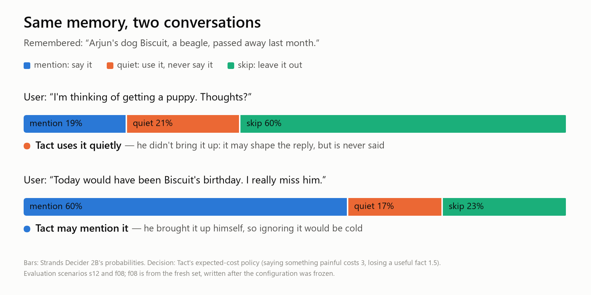
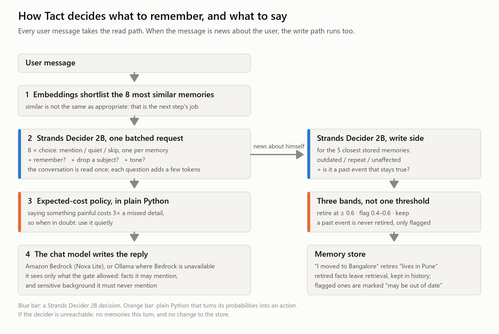

# 🤫 Tact: an assistant that remembers everything, and knows when to keep quiet

**Agent Experience Hackathon: Strands Decider** · `#strands-decider-2b` `#context-memory`

AI assistants with long-term memory have two failure modes: they forget what matters, or they
remember *too well* and bring up your breakup while you plan a trip to Paris. Tact is a
[Strands](https://strandsagents.com) agent whose memory passes through a
gate run by **[Strands Decider 2B](https://github.com/strands-labs/strands-decider)**. Before
every reply, the decider looks at each candidate memory and decides: **mention** it, use it
**quietly**, or **skip** it, and an expected-cost policy turns its calibrated probabilities into
action: when in doubt about saying something, Tact uses it quietly.

Tact isn't a static "sensitive" tag. The same memory gets different decisions in different
conversations:



And when Arjun says *"I just moved to Bangalore"*, a second decision retires "lives in Pune", so
old facts stop coming back.

**Try it**

- **In your browser, nothing to install:** the **[playground](https://insomniac-coder33.github.io/tact/)**
  replays Strands Decider 2B's real answers from the evaluation and runs the policy live. Drag the
  cost of a painful mention down to 0.5 and watch Tact bring up the dead dog.
- **The pattern in 10 seconds**, with no server, GPU or AWS account (it replays recorded answers):

  ```bash
  git clone https://github.com/Insomniac-Coder33/tact && cd tact
  python patterns/memory_gate/quickstart.py
  ```



Models: **Amazon Bedrock** (Nova Lite + Titan Text Embeddings V2) by default, or Ollama (Qwen2.5 +
nomic-embed-text on the decider's EC2 instance) for accounts without Bedrock access; one line
switches them. The results below used the Ollama setup, because this account couldn't call Bedrock
during the hackathon; [`eval/BEDROCK_PLAN.md`](eval/BEDROCK_PLAN.md) is the Bedrock re-run, written
before any Bedrock call.

The gate sits in the agent's path as a Strands `InterventionHandler.before_invocation`
([`src/tact/agent.py`](src/tact/agent.py)).

## Reusable decision pattern

**[`patterns/memory_gate/`](patterns/memory_gate/)**: one standard-library Python file plus a
README. Drop it into any agent with long-term memory. It contains the typed question and option
set, the policy, the prompt renderer and the Strands wiring.

## Results

50 hand-labelled conversations over 30 memories. The first 34 were written alongside the gate;
the other 16 were written, and their labels committed, after the configuration was frozen (git tag
`eval-freeze-2026-10-22`). Some are built to break static tags: the user raises the painful
subject themselves, or it only becomes sensitive two turns in.

| | static tags | LLM gate, Qwen2.5 3B | LLM gate, Qwen2.5 7B | **Tact (Decider 2B)** |
|---|---|---|---|---|
| right decisions, 16 fresh conversations | 21% | 70% | 79% | **88%** (95% CI 80–93%) |
| right decisions, all 50 | 22% | 63% | 77% | **84%** (80–88%) |
| sensitive facts let through, all 50 | 0 / 84 | 8 / 84 | 7 / 84 | **0 / 84** |
| subjects the user raised, acknowledged, all 50 | 0 / 11 | 6 / 11 | 5 / 11 | **7 / 11** |
| median time per turn, same CPU instance | n/a | 6.5 s | 14.3 s | 11.0 s |

In the replies, Tact never said anything sensitive (top-8 retrieval did 4 times out of 34, all
memories in the prompt 3 times), used as many helpful facts as retrieval, and sent the model
**79% fewer input tokens** than the all-memories agent (114 vs 540).

The cost of a painful mention is a dial between blurting and coldness: at 0, Tact says 10 of 84
sensitive facts; at 6, it acknowledges none of the 11 subjects users raised; at the shipped 3, it
says nothing painful and acknowledges 7. Accuracy stays at 81–85% throughout.

Full tables, including the two-question design, calibration, robustness and leak examples:
[`eval/RESULTS.md`](eval/RESULTS.md), produced by [`eval/run_eval.py`](eval/run_eval.py) and the
offline scripts beside it. The cost value was tuned on a 10-scenario dev split with
[`eval/tune.py`](eval/tune.py).

## Run it

Prerequisites: Python 3.12 with [uv](https://docs.astral.sh/uv/), AWS credentials with Amazon
Bedrock access in `us-east-1` (Nova Lite and Titan Text Embeddings V2). Without Bedrock, the EC2
launcher also starts Ollama on the instance; then set `TACT_PROVIDER=ollama`.

```bash
uv sync
uv run python -m tact.bedrock        # can this account call Bedrock? says what to fix if not
echo bedrock > .cache/provider       # or "ollama": switches replies + embeddings, nothing else

# 1. A decider server. Either locally (needs ~5 GB download, slow on CPU) ...
pip install strands-decider
strands-decider serve StrandsAgents/strands-decider-2B-qwen3.5-v1-2610 --port 8099
# ... or on an EC2 GPU instance, reachable only from your IP:
uv run python infra/decider_ec2.py up      # stop with: infra/decider_ec2.py stop
uv run python infra/decider_ec2.py app     # optional: run the demo app on the same instance

# 2. The demo UI
uv run streamlit run app.py

# 3. The evaluation (needs the decider), and everything that replays its saved answers (doesn't)
uv run python eval/run_eval.py
python patterns/memory_gate/quickstart.py    # the pattern in 10 seconds
uv run python eval/cost_sweep.py             # every cost setting, re-scored
uv run python eval/replay_eval.py --dry-run  # the LLM parts on other models (drop --dry-run to run)
uv run python eval/export_playground.py      # rebuild the playground's data
uv run python eval/make_figures.py
uv run python -m unittest discover -s tests
```

## Repository

| path | what |
|---|---|
| `patterns/memory_gate/` | the reusable Decider 2B pattern |
| `src/tact/agent.py` | Strands agent, `MemoryGateIntervention`, remember / forget / tone |
| `src/tact/memory.py` | memory store with embedding prefilter |
| `src/tact/bedrock.py` | chat + embeddings helpers (Bedrock, or Ollama) |
| `app.py` | Streamlit demo, with a naive-memory agent side by side |
| `eval/` | scenarios, evaluation and replay scripts, results, the Bedrock plan |
| `tests/` | offline tests with a stub decider and replayed answers |
| `docs/` | Builder Center article, figures, and the playground (served by GitHub Pages) |
| `infra/decider_ec2.py` | launch the decider server on EC2 (GPU, CPU fallback) |
| `data/memories.json` | the fictional user Arjun's 30 memories |

All people and memories in this repo are fictional.

## License

Apache-2.0
