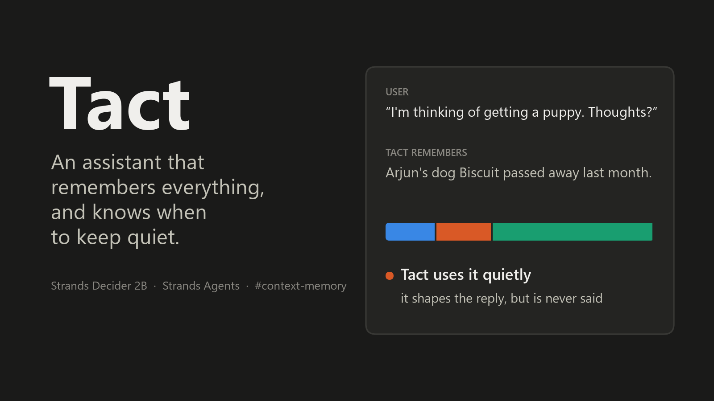

# Tact: teaching a memory agent when to keep quiet, with Strands Decider 2B

*Tags: #strands-decider-2b #context-memory*



**At a glance**

- **The decision:** before every reply, for each remembered fact that might matter, Strands
  Decider 2B decides whether the agent may **mention** it, should use it **quietly** (let it
  shape the reply, never say it), or **skip** it. A second decision runs when the user shares
  news: does it make an old memory **outdated**?
- **Decision pattern:** context and memory. **Decision model:** Strands Decider 2B on an Amazon
  EC2 instance. **Generative model:** built for Amazon Bedrock (Nova Lite); see the note below on
  what ran during the hackathon.
- **Results:** on 16 conversations written *after* the configuration was frozen, Tact made **88%**
  of its decisions right, against 70% for an LLM asked the same question and 21% for static
  "sensitive" tags. It let **0 of 24** sensitive facts through (the LLM: 3). Across all 50 test
  conversations: **0 of 84**, against 8.
- **Try it without installing anything:** [the playground](https://insomniac-coder33.github.io/tact/)
  replays the decider's real answers and lets you change the policy. **Code:**
  https://github.com/Insomniac-Coder33/tact (Apache-2.0). **Demo video:** `[[VIDEO_URL]]`

## The problem: assistants that remember too well

Ask an AI assistant with long-term memory for sightseeing tips in Paris. It finds the memory that
matches "Paris" most closely and helpfully writes:

> "Since your last trip to Paris ended with the breakup with Meera, maybe try a different
> neighbourhood this time..."

Retrieval worked as designed. It found the most *similar* memory, not an *appropriate* one. People
with good memories don't say everything they remember. A friend knows not to suggest a dog park the
month your dog died, and doesn't explain why.

## Why not just tag the painful memories?

The obvious fix is to mark painful memories as sensitive when they're saved, and never say them.
But tact depends on the conversation:


*"I'm thinking of getting a puppy"* should be shaped by the dog that died last month (maybe wait a
little), but saying it would hurt. *"Today would have been Biscuit's birthday. I really miss him"*
is the opposite: now **not** acknowledging Biscuit would be cold. Same memory, two conversations,
two right answers. A static tag gets one of them wrong every time, so the decision has to be made
per message, and it has to be cheap enough to make on every turn.

## Isn't this just a relevance filter?

Most memory gates ask one question: *is this fact relevant to the message?* That has two outcomes,
in or out. But the dead dog **is** relevant
to "should I get a puppy?". A relevance filter has to either put it in the prompt, where the model
may well bring it up, or drop it, so the reply can't take it into account.

Tact's middle lane is the point: **relevant, but not sayable**. A quiet fact still reaches the
model, under a heading that says *sensitive background: let it shape your answer, never mention
it*. It's also the hardest call, and I'll show below how rarely the decider makes it on its own.

## Why not just tell the model to be tactful?

Tact's system prompt already says *"Use what you remember only when it genuinely helps, and never
make the user feel watched."* The baseline agent that gets every memory had the same prompt. Asked
for a sweet to bring to his sister's wedding, it still suggested his late grandmother's rasgulla,
"a reminder of her".

A general instruction leaves the model to work out, in the middle of writing, which of 30 facts are
painful *right now*. Tact works that out first, one fact at a time, and hands the model a short list
with the sensitive ones marked.

## How it works


1. **Shortlist.** Embeddings pick the 8 stored memories most similar to the message. Similar is
   not the same as appropriate; that's the next step's job.
2. **Decide.** Strands Decider 2B gets **one** request: a three-way question for each of the 8
   memories, plus three yes/no and choice questions that ride along (more below). It reads the
   conversation once, and each extra question only adds a few tokens.
3. **Policy.** Plain Python turns the decider's probabilities into an action with a cost table.
4. **Reply.** The chat model writes the answer, seeing only what the gate allowed.

Everything runs on AWS. Decider 2B is served on an EC2 instance. Tact was built for Amazon Bedrock
(Nova Lite for replies, Titan Text Embeddings V2 for the shortlist), but my brand-new AWS account
couldn't call Bedrock models during the hackathon. So the replies and embeddings in this article
come from Qwen2.5 3B and nomic-embed-text, served by Ollama on the same EC2 instance as the
decider. One setting (`echo bedrock > .cache/provider`) switches between the two; the gate doesn't
change. The repo includes a written plan for re-running every LLM part on Bedrock (Nova Lite and
Nova Pro as baselines), committed before any Bedrock call.

## The decision

Each memory becomes one typed `choice` question, and all of them go to the decider in a single
request:

```python
{
  "type": "choice",
  "instructions": "An AI assistant is about to reply to the user's latest message. "
                  "It remembers this fact about the user:\n{memory}\n"
                  "How should the assistant treat this fact in its reply?",
  "criteria": {
    "mention": "use it openly: it makes the reply more useful or personal (a preference, "
               "constraint, plan or interest that fits the request), and bringing it up feels natural",
    "quiet":   "use it silently: it is related to the request, but saying it out loud could hurt, "
               "embarrass or upset the user, so it should only make the reply more careful",
    "skip":    "ignore it: it has no bearing on what a good reply would say"
  }
}
```

I tried several wordings on a 10-conversation development split and kept the best. I also tried
two narrow yes/no questions per memory ("would this fact change a thoughtful reply?", "would saying
it be unwelcome, given the conversation so far?"). It looked cleaner on paper and lost: 74% against
83%, one sensitive fact let through, and almost twice the decider time. Both designs are in the repo.

## The policy: expected cost, not the top label

The decider returns probabilities, not just a label, and Tact uses all of them. Mistakes don't
cost the same: saying something painful is far worse than leaving out a useful detail. So the
gate picks the action with the lowest **expected cost**:

| action ↓ / truth → | mention | quiet | skip |
|---|---|---|---|
| **mention** | 0 | **3** (said something painful) | 0.5 |
| **quiet** | 1 (held back a useful fact) | 0 | 0.4 |
| **skip** | 1.5 (lost a useful fact) | 1 | 0 |

```python
def decide(self, probabilities, locked=False):
    expected = {a: sum(probabilities[t] * c for t, c in row.items())
                for a, row in self.cost.items()}
    if locked:                       # the user asked never to hear about it
        expected.pop("mention")
    return min(expected, key=expected.get)
```

In the puppy conversation above, the decider's top label for Biscuit was *skip* (60%). But 21% on
*quiet* and 19% on *mention* make the fact worth carrying, so the policy uses it quietly. Without
probabilities there's nothing to weigh, and the trade-off lives in a table your team can argue
about, not in a prompt.

**The cost decides which mistakes the agent makes, not how many.** Re-scoring the same recorded
answers across all 50 conversations:

| cost of saying something painful | right decisions | sensitive facts said ↓ | subjects the user raised, acknowledged ↑ |
|---|---|---|---|
| 0 | 84% | 10 / 84 | 10 / 11 |
| 1 | 84% | 5 / 84 | 10 / 11 |
| 2 | 85% | 4 / 84 | 9 / 11 |
| **3 (shipped)** | **84%** | **0 / 84** | **7 / 11** |
| 6 | 81% | 0 / 84 | 0 / 11 |

Accuracy hardly moves. What moves is the kind of failure: a cheap painful mention makes the agent
blurt, an expensive one makes it cold. 3 was chosen on the 10-conversation development split; on
all 50 it's the lowest value, in steps of 0.25, that says nothing painful. You can drag this dial yourself in the
[playground](https://insomniac-coder33.github.io/tact/#s=s12&c=0.5&set=all): at 0.5, Tact brings up
the dead dog when asked about a puppy.

The table also beats the decider's own top label. On the fresh conversations, taking the top label
as-is gets 83% right, keeps 10 of 19 useful facts and lets one sensitive fact through; the cost
table gets 88%, keeps 15 and lets none through.

## Wiring it into a Strands agent

The gate is a Strands `InterventionHandler`. Its `before_invocation` runs once per user message,
before any model call, and returns a `Transform` that rewrites the system prompt:

```python
class MemoryGateIntervention(InterventionHandler):
    def before_invocation(self, event, **kwargs):
        latest = latest_user_text(event)
        result = self.gate.safe_run(conversation, self.store.candidates(latest, k=8))
        prompt = f"{SYSTEM_PROMPT}\n\n{render_context(result)}"
        return Transform(apply=lambda e: setattr(e.agent, "system_prompt", prompt))

agent = Agent(model=model, interventions=[MemoryGateIntervention(gate, store)])
```

Two rules cover every failure. When Tact is unsure about **saying** something, it says less. When
it's unsure about **changing** what it knows, it changes nothing. If the decider is unreachable,
the agent still answers, but with no memories that turn, never a stale or ungated block. The
pattern's README has the full table, with one test per row.

### Three more decisions, in the same request

Once the conversation is encoded, extra questions are nearly free:

- **Remember?** (`noul`) Is the user sharing news about themselves, rather than asking for
  something? Only when the decider is at least 70% sure does Tact spend an LLM call writing it down.
- **Forget?** (`noul`) *"Please don't bring up Meera again."* A short follow-up asks which memory
  they mean and locks it: it can still keep answers considerate, but it's never said again.
- **Tone?** (`choice`: gentle / upbeat / practical) Adjusts how the reply should feel.

### The other half of memory: noticing what's out of date

Tact knows "Arjun lives in Pune". Then Arjun says *"Big news: I just moved to Bangalore for a new
job!"* An agent that only appends now holds both, and next Saturday it may suggest a walk in Pune.

So writing gets its own decision. When the remember question fires, one more request asks, for
each of the 5 closest stored memories: does this message make it **outdated**, **repeat** it, or
leave it **unaffected**? Deleting a true memory and keeping a stale one are both mistakes, so there
are three bands: at P(outdated) ≥ 0.6 the memory is **retired** (out of retrieval, kept in
history); from 0.4 it's kept but **flagged**, and the model is told it *may be out of date*.

The first live test retired *"was laid off in March 2025"* after *"I got a new job"*. But a past
event stays true when life moves on. Writing that into the options made every probability drift and
caused four wrong retirements. What worked was a separate yes/no question in the same request: *is
this a past event that's over and done?* If so, the memory can be flagged but never retired. On 27
hand-labelled messages, the curator retired 9 of 17 outdated memories, flagged 5 more, and retired
**none of the 60 that were still true**.

## Does it work?

I wrote 34 everyday requests over a fictional user, Arjun, with 30 memories: useful ones like his
peanut allergy, budget and sister's wedding, and painful ones like a breakup, a dog that died, a
layoff and his father's heart surgery. Ten conversations are built to break static tags: the user
raises the painful subject themselves, or it only becomes sensitive two turns in. Every shortlisted
memory has a hand label: mention, quiet or skip.

Those 34 were written by the person who built the gate, alongside it. So I froze everything that
affects a decision (git tag `eval-freeze-2026-10-22`), wrote **16 new conversations**, and
committed their labels, with the file's hash, before any model saw them. Every gate judges the
same 8 shortlisted memories:

| gate, on the 16 fresh conversations | right decisions (95% CI) | sensitive facts let through ↓ | user-raised subjects mentioned ↑ | useful facts kept ↑ |
|---|---|---|---|---|
| static tags | 21% (14–30%) | 0 / 24 | 0 / 4 | 19 / 19 |
| LLM gate: Qwen2.5 3B, same question | 70% (60–78%) | 3 / 24 | 4 / 4 | 13 / 19 |
| **Tact** | **88% (80–93%)** | **0 / 24** | 3 / 4 | 15 / 19 |

On the original 34: Tact 83%, the LLM gate 60%, tags 23%, and 85% vs 61% vs 19% on the 24
conversations that weren't used for tuning. Across all 50, Tact let **0 of 84** sensitive facts
through (95% CI 0–4%); the LLM gate let 8 through.

The LLM gate's slips are exactly the kind this project is about. Asked for job-interview tips, it
allowed Arjun's therapy for anxiety. Asked what to gift his dad, it allowed the heart surgery.
Asked to suggest activities for his recovering dad, it allowed his layoff.

Tags look safe, and they are, but they get three out of four decisions wrong: every helpful fact is
"mentioned", relevant or not, and a painful subject can never be acknowledged, even when the user
brings it up.

**Then the replies.** Five agents answered all 34 requests with the same chat model:

| how the agent gets its memory | replies that said something sensitive ↓ | helpful facts used ↑ | input tokens per reply ↓ |
|---|---|---|---|
| all memories in the prompt | 3 / 34 | 30 / 70 | 540 |
| top-8 retrieval (RAG) | 4 / 34 | 32 / 70 | 208 |
| retrieval + static tags | 1 / 34 | 33 / 70 | 243 |
| retrieval + LLM gate | 0 / 34 | 26 / 70 | 143 |
| **Tact** | **0 / 34** | 32 / 70 | **114** |

Asked *"What should I do this Saturday morning?"*, the retrieval agent suggested taking Biscuit for
a relaxing walk at the lake. Tact never said anything painful, used as many helpful facts as plain
retrieval, and sent the model **79% fewer input tokens** than the all-memories agent, because it
passes on only what the decider allowed. Every reply is in the playground, side by side.

### Can you trust its confidence?

A probability is only useful if it means something. Across 260 labelled decisions, when the
decider gave its top label 90% or more, it was right **97 times out of 97**. Between 80% and 90%,
87%. Below 80%, close to a coin flip (50–59%). Its expected calibration error is 0.06.


So the signal says which decisions deserve a second look. The demo shows a "close call" badge
below 0.33 confidence. Handing just those to the 3B LLM didn't help (215 right alone, 217 at
best), because the cases the decider finds hard are hard for that LLM too; a Bedrock model may do
better, and that's in the plan.

It's also repeatable: two separate runs gave identical probabilities on all 272 decisions. The 3B
LLM gate, at temperature 0, changed one of its 272 labels between the same two runs.

## What I learned about using Decider 2B

- **Batch everything that reads the same conversation.** Eight memory questions plus remember,
  forget and tone go in one request; the extra questions cost a few tokens each, not another call.
- **Ask about what's observable, not about value.** "Does this message reveal a fact worth
  remembering?" never reached 0.7 on ten pieces of real news. "Is the user mainly sharing news
  about themselves, rather than asking for something?" caught all ten, with no false alarms on
  eight plain requests.
- **Fix one bad case with a new narrow question, not a longer option.** Adding a clause to an
  option description moved every probability. The separate past-event question fixed the case and
  left the rest alone.
- **Keep the probabilities, tune on saved answers.** The cost sweep, the calibration chart and the
  playground all replay stored answers, without calling the model again.
- **It's good at relevance, and at noticing when the user opens a subject.** When Arjun says he
  misses Biscuit, P(mention) for Biscuit goes from 19% to 60%.
- **It rarely picks "quiet" on its own.** Of the 21 facts I labelled quiet, Tact kept 5 quiet and
  skipped 16; it said none of them. Safe, but the quiet lane leans on the cost table more than on
  the label.

## Limits

- **Bedrock.** My new account couldn't call Bedrock during the hackathon, so the LLM baseline and
  the replies use Qwen2.5 3B. A larger Bedrock model would be a stronger baseline; the re-run plan
  (`eval/BEDROCK_PLAN.md`) is committed and its results will be reported whatever they show.
- **Speed.** The decider ran on CPU (no GPU quota): about 10 seconds per gate call, slower than
  the 3B LLM gate on the same machine. The published figure on a GPU is around 115 ms per question;
  I couldn't measure that.
- **Missed facts.** Tact kept 15 of 19 useful facts on the fresh set and missed 1 of 4 subjects the
  user raised. Asked for a Thai dish, it skipped a severe peanut allergy; safety constraints like
  allergies may be better handled by a rule than by a judgement call.
- **Option order matters a little.** Asked with the options in three different orders, the
  decider's top label changed in 3% of decisions, never towards the first-listed option. But the
  final action changed in 9%, and the two other orders let 1 and 2 sensitive facts through. "Zero"
  holds for the order I shipped, not for every order.
- **Small, single-author data.** 50 conversations, labelled by me. "Said something sensitive" in
  the replies is a keyword check, which can miss paraphrases. Read the numbers as a signal, not a
  benchmark; the evaluation scripts are in the repo to rerun on your own memories.

## Reuse it

The pattern is one standard-library Python file, `patterns/memory_gate/memory_gate.py`, plus a
README, a notebook and tests: the questions, both designs, the cost-table policy, the write-side
curator, the prompt renderer and the Strands wiring.

```bash
python patterns/memory_gate/quickstart.py   # 10 seconds, no server, GPU or AWS account
```

```python
from memory_gate import MemoryGate, http_ask, render_context

gate = MemoryGate(http_ask("http://127.0.0.1:8099"))
result = gate.safe_run(conversation=[("user", "Any tips for my trip to Paris?")], memories=memories)
system_prompt = BASE_PROMPT + "\n\n" + render_context(result)
```

- **Playground:** https://insomniac-coder33.github.io/tact/
- **Code (Apache-2.0):** https://github.com/Insomniac-Coder33/tact
- **Demo video:** `[[VIDEO_URL]]`

A good memory isn't one that remembers everything. It's one that knows what to leave unsaid.
