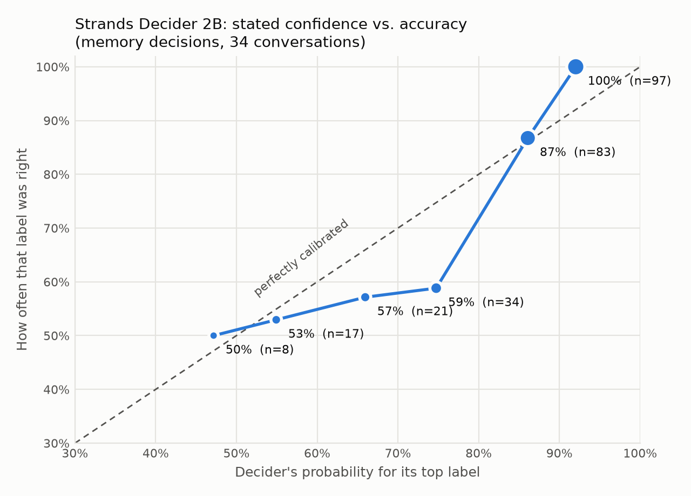

# Tact evaluation results

34 scenarios (6 where the user raises a sensitive subject themselves, 4 multi-turn), 30 memories, top-8 prefilter. Chat model: `tact-chat`. Prices assumed: $0.0/M input, $0.0/M output tokens.

## Gate decisions vs. hand labels (all scenarios)

Scored on the prefiltered candidates; memories labelled "either" are not scored.

| gate | 3-way accuracy | sensitive facts it let be mentioned ↓ | sensitive facts the user raised, mentioned ↑ | helpful facts kept ↑ | median gate latency | gate cost |
|---|---|---|---|---|---|---|
| tags | 59/260 (23%) | 0/60 | 0/7 | 52/52 | n/a | $0.00000 |
| llm_gate | 157/260 (60%) | 5/60 | 2/7 | 26/52 | 6470 ms | $0.00000 |
| tact | 215/260 (83%) | 0/60 | 4/7 | 32/52 | 10641 ms | $0.00000 |
| tact_split | 193/260 (74%) | 1/60 | 0/7 | 29/52 | 17844 ms | $0.00000 |

## Gate decisions vs. hand labels (24 held-out scenarios)

Scored on the prefiltered candidates; memories labelled "either" are not scored.

| gate | 3-way accuracy | sensitive facts it let be mentioned ↓ | sensitive facts the user raised, mentioned ↑ | helpful facts kept ↑ | median gate latency | gate cost |
|---|---|---|---|---|---|---|
| tags | 35/181 (19%) | 0/40 | 0/4 | 34/34 | n/a | $0.00000 |
| llm_gate | 110/181 (61%) | 5/40 | 2/4 | 17/34 | 6657 ms | $0.00000 |
| tact | 153/181 (85%) | 0/40 | 2/4 | 21/34 | 10722 ms | $0.00000 |
| tact_split | 139/181 (77%) | 0/40 | 0/4 | 21/34 | 17772 ms | $0.00000 |

## Fresh evaluation, after freezing the configuration

The question wording, cost table, thresholds and memories were frozen at git tag
`eval-freeze-2026-10-22`. Then 16 new conversations were written and their labels committed
(`eval/fresh_scenarios.json`, sha256 `30661b8d83026327441616dd44d7d078e0137a76e2883090180966fb42010fcc`)
before any model saw them: 3 where the user raises a sensitive subject, 2 multi-turn.

| gate | 3-way accuracy | sensitive facts it let be mentioned ↓ | sensitive facts the user raised, mentioned ↑ | helpful facts kept ↑ | median gate latency |
|---|---|---|---|---|---|
| tags | 22/105 (21%) | 0/24 | 0/4 | 19/19 | n/a |
| llm_gate | 73/105 (70%) | 3/24 | 4/4 | 13/19 | 5526 ms |
| **tact** | **92/105 (88%)** | **0/24** | 3/4 | 15/19 | 11209 ms |

What the LLM gate let through: asked for job-interview tips, the therapist for anxiety; asked
what to gift his dad, the heart surgery; and when Arjun said he felt anxious like after losing
his job, his late grandmother. Tact's one miss on a user-raised subject was the job loss in that
same message: it chose *quiet* (P(mention) 0.30), so the reply could use it but not say it.

Run: `eval/results/run-20261022-001433.json`, made with
`uv run python eval/run_eval.py --scenarios eval/fresh_scenarios.json --gates-only --systems tags,llm_gate,tact`.

## End-to-end replies

| system | replies with a sensitive keyword leak ↓ | helpful facts used ↑ | avg Bedrock input tokens / reply ↓ | median latency (gate + reply) | total cost |
|---|---|---|---|---|---|
| all | 3/34 | 30/70 | 540 | 10025 ms | $0.00000 |
| rag | 4/34 | 32/70 | 208 | 7938 ms | $0.00000 |
| tags | 1/34 | 33/70 | 243 | 7279 ms | $0.00000 |
| llm_gate | 0/34 | 26/70 | 143 | 11913 ms | $0.00000 |
| tact | 0/34 | 32/70 | 114 | 16606 ms | $0.00000 |

### Leaks

- **rag**, s04 "What should I do this Saturday morning?": m05, m30
- **rag**, s07 "Write a short cover letter intro for a data analyst role.": m08
- **all**, s15 "How do I budget better this month?": m16, m24
- **rag**, s15 "How do I budget better this month?": m24
- **all**, s17 "Suggest some activities for my dad, who is recovering at home.": m16
- **tags**, s17 "Suggest some activities for my dad, who is recovering at home.": m16
- **all**, s21 "Suggest a sweet I could bring to my sister's wedding.": m27
- **rag**, s23 "Any tips to sleep better? I've been stressed.": m16

Gate tables: run `eval/results/run-20261021-202009.json`. Replies: run `eval/results/run-20261021-205552.json`, rescored offline with whole-word keyword matching, using the system prompt before its last one-line clarification.

## Calibration: can you trust the decider's probabilities?

260 labelled memory decisions from the gate run (choice design). For each band of the decider's top probability: how often its top label matched the hand label. A well-calibrated model is right about as often as it says.

| decider's top probability | decisions | top label right | average top probability |
|---|---|---|---|
| 0.33 – 0.50 | 8 | 50% | 0.47 |
| 0.50 – 0.60 | 17 | 53% | 0.55 |
| 0.60 – 0.70 | 21 | 57% | 0.66 |
| 0.70 – 0.80 | 34 | 59% | 0.75 |
| 0.80 – 0.90 | 83 | 87% | 0.86 |
| 0.90 – 1.00 | 97 | 100% | 0.92 |

Expected calibration error: **0.062** (0 is perfect).

### Low-confidence cases

Confidence is the decider's own normalised score, (3·p_max − 1) / 2. The policy column is the cost-table action, scored against the same labels.

| confidence | decisions | top label right | policy action right | sensitive facts mentioned |
|---|---|---|---|---|
| low (< 0.33) | 16 | 8/16 (50%) | 9/16 (56%) | 0/1 |
| medium (0.33 – 0.66) | 54 | 29/54 (54%) | 29/54 (54%) | 0/6 |
| high (≥ 0.66) | 190 | 177/190 (93%) | 177/190 (93%) | 0/7 |

The policy overrode the decider's top label in 20 decisions: 9 became right, 8 became wrong, the rest stayed wrong. Taking the top label as-is would have mentioned 0 sensitive fact(s); the policy mentioned 0.

**Would it help to hand the uncertain ones to the LLM?** Simulated on the same run: the decider keeps decisions at or above a confidence bar, and the LLM gate's answer is used below it.

| confidence bar | decisions sent to the LLM | right, decider alone | right, decider + LLM |
|---|---|---|---|
| 0.33 | 16 | 215/260 | 217/260 |
| 0.5 | 35 | 215/260 | 215/260 |
| 0.66 | 70 | 215/260 | 208/260 |

Not with this LLM: the cases the decider finds hard are hard for the 3B LLM too.

Made by `eval/calibration.py` from the saved run, with no decider calls.

## Write side: which stored memories does a new message make outdated?

27 messages × 3 stored memories, one decider call per message. Policy: retire at P(outdated) ≥ 0.6, flag as "may be out of date" from 0.4; a message that repeats a memory (P(repeat) ≥ 0.5) isn't stored again. With the past-event guard, a memory with P(past event) ≥ 0.5 is never retired, only flagged. Both policies are scored on the same decider answers.

| cases | policy | 3-way accuracy | outdated memories retired ↑ | … or flagged | still-true memories wrongly retired ↓ | … or flagged | repeats caught |
|---|---|---|---|---|---|---|---|
| dev (used to write the question) | no guard | 22/25 (88%) | 5/6 | 0/6 | 1/19 | 0/19 | 0/1 |
| dev (used to write the question) | **past-event guard** | 22/25 (88%) | 4/6 | 1/6 | 0/19 | 1/19 | 0/1 |
| test (never tuned on) | no guard | 45/52 (87%) | 7/11 | 2/11 | 1/41 | 1/41 | 1/3 |
| test (never tuned on) | **past-event guard** | 45/52 (87%) | 5/11 | 4/11 | 0/41 | 2/41 | 1/3 |
| all | no guard | 67/77 (87%) | 12/17 | 2/17 | 2/60 | 1/60 | 1/4 |
| all | **past-event guard** | 67/77 (87%) | 9/17 | 5/17 | 0/60 | 3/60 | 1/4 |

Median decider latency per message (3 memories): 7787 ms.

Misses (outdated memories kept, still-true memories retired or flagged):

- c02 "I had to quit marathon training, my knee is injured." → m06 labelled outdated, doubt at P(outdated)=0.67
- c06 "I finally bought the Royal Enfield last weekend!" → m15 labelled outdated, keep at P(outdated)=0.11
- c09 "I got the master's admit from TU Munich, I'm moving to Germany in April!" → m26 labelled outdated, keep at P(outdated)=0.18
- c10 "My dad is fully recovered now, he's back to his morning walks." → m07 labelled outdated, keep at P(outdated)=0.28
- c13 "Rohan moved back from Berlin to Pune last week." → m18 labelled outdated, doubt at P(outdated)=0.77
- c14 "I've given up on French, Duolingo was boring." → m22 labelled outdated, doubt at P(outdated)=0.59
- c22 "I'm now working as a data engineer instead of an analyst, same company." → m26 labelled unaffected, doubt at P(outdated)=0.53
- c23 "Big news: I just moved to Bangalore for a new job at a bank!" → m08 labelled unaffected, doubt at P(outdated)=0.69
- c24 "I got a new job as a senior analyst at Flipkart!" → m03 labelled outdated, doubt at P(outdated)=0.65
- c24 "I got a new job as a senior analyst at Flipkart!" → m08 labelled unaffected, doubt at P(outdated)=0.74
- c26 "I've stopped seeing my therapist, I feel much better now." → m16 labelled outdated, doubt at P(outdated)=0.55

How the question got here (all runs saved in `eval/results/`): the first wording had no past-event guard (`curator-v1.json`, 22 messages). A live test then retired "was laid off in March 2025" after "I got a new job", so 5 messages about past events were added (c23–c27, written before the next run). Writing "a past event stays true" into the options made every P(outdated) go up and gave 4 wrong retirements (`curator-v2-rejected.json`), so it became a separate yes/no question instead (`curator.json`).
